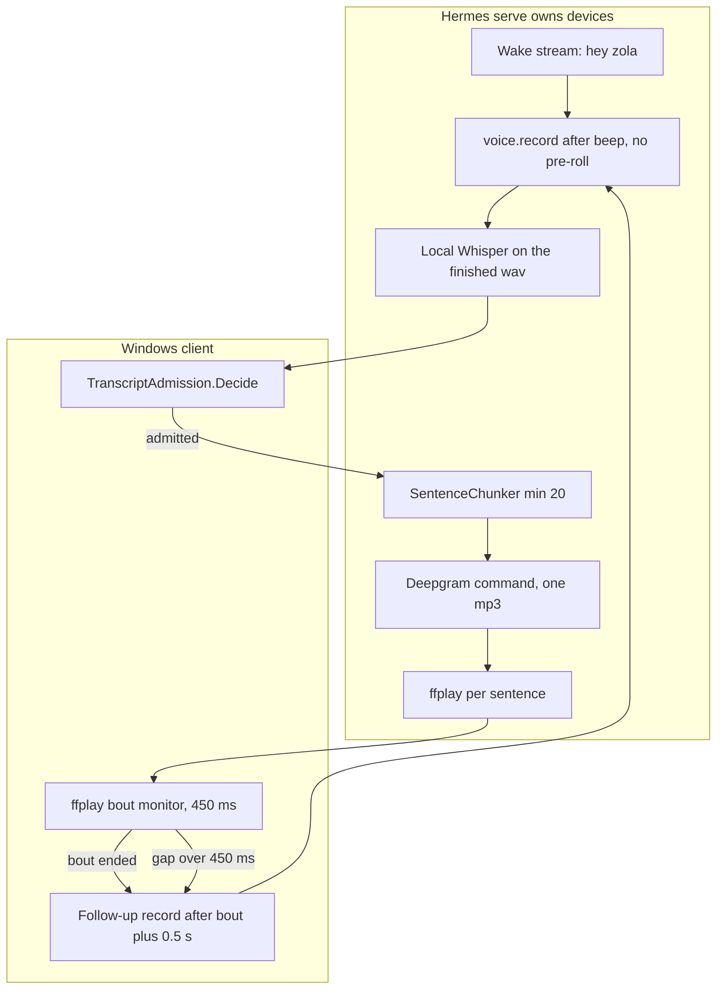
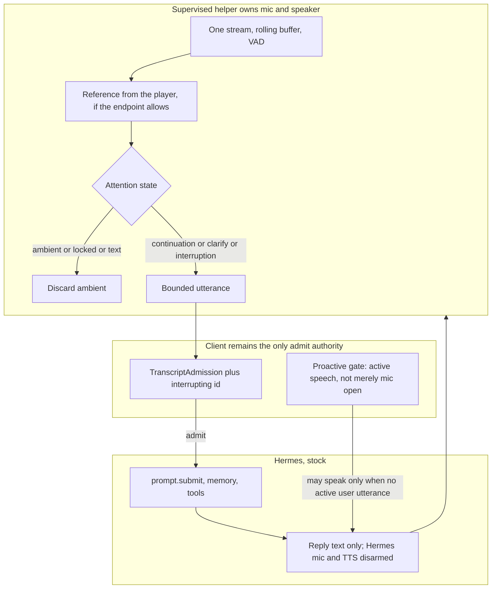

# VOICEPRE Audit — Synthesis

Standalone feasibility study of talk-over barge-in and wake-free conversation. Read-only. **No live reproduction was run.** No architecture was approved and no build was authorized.

## Executive summary

Zola's microphone and speaker belong to the Hermes process. The Windows client asks that process to listen, and it watches ffplay to guess when she has finished. Talking over her is switched off on purpose: the full-duplex listener treated a spoken answer as an interruption, so Phase 4 left `voice.barge_in` false. That decision still stands. Turning the flag back on would cut her audio and then drop the words, because Phase 7 only accepts a transcript from a capture it already owns.

The opening words of an answer are easy to lose for a reason that is in the code: `voice.record` plays a beep and only then starts keeping samples. There is no rolling buffer on that path. Whether that is the clip Brian still hears, or a different cut, was not tested.

Her own voice can still become his turn. The protection is a text comparison after the fact. It ignores anything under three words, and it only looks at the end of what she just said. Separately, each sentence is its own mp3 played by a new ffplay. If the gap between those processes lasts longer than 450 milliseconds, the client decides she has finished and opens the microphone while a later sentence may still be on the way. That shape was seen once after the Deepgram switch. It is a candidate for the echo he reported on 2026-10-18, not a proven cause.

Wake-free conversation is not built. "Hey Zola", the mic button, or Ctrl+Space starts one utterance. The master plan's attention section is a target. Android's directedness logic gates whether she speaks unprompted. It does not decide which things she heard were meant for her.

The live voice is Deepgram Aura-2 Pandora at speed 0.95, through a command that writes a file per sentence. The canonical `VOICE_CONFIG.md` still says Edge. Old Edge timings do not describe this voice. How long the current gaps are was not measured.

Config and plugins cannot fix this. The shortest repair for talk-over and the missing first words is a small Hermes voice patch plus a matching admission rule, and that needs permission to edit the pinned voice layer. The path that can also hold a continuous, wake-free stream without forking the rest of Hermes is a supervised helper that owns capture and playback, with Hermes kept as the brain. That helper is not chosen because an earlier note liked it. It is the option that covers both jobs, and it is unproven until the scripted proof runs on today's actual mic and speakers. A headset can reduce echo. It does not add the buffer or the listener.

Decisions needed from Brian: whether a Hermes voice patch is allowed; whether a helper may own the devices; whether idle listening may exist and what it is forbidden to store; the hardware facts in Audit 01; and the numeric bars in Audit 07.

## 1. Findings

Fifteen findings. Four matches, six gaps, five risks. Info notes are not in this count.

| ID | Label | Severity | Scope | Requirement | Summary |
|---|---|---|---|---|---|
| VOICEPRE-AUD-01 | [MATCH] | N/A | Hermes `methods_voice.py` L1–4; client monitor | P2-D01, C3 | Serve owns mic and speaker. Client does not open a device. |
| VOICEPRE-AUD-02 | [MATCH] | N/A | `_arm_barge_listener_if_enabled` L158–161 | P4-D28 | `barge_in` false means the full-duplex listener is not armed. |
| VOICEPRE-AUD-03 | [MATCH] | N/A | `TranscriptAdmission.Decide` | P7-D01 | One function admits or drops a transcript. Echo cannot admit. |
| VOICEPRE-AUD-04 | [MATCH] | N/A | `VoiceController` follow-up; monitor | P7-D06, P4-D18 | An estimate does not open the mic while a bout is active. |
| VOICEPRE-AUD-05 | [GAP] | HIGH | Same arm as AUD-02 | S36, P5-D08, SYM-03 | Talk-over was deliberately deferred. The flag is the deferral. |
| VOICEPRE-AUD-06 | [RISK] | HIGH | `_fd_trip` L219–246; `Decide` | P7-D04, P4-D28, SYM-03 | A flag flip cuts audio, latches an interruption, ignores clarify, and the words are dropped. |
| VOICEPRE-AUD-07 | [GAP] | HIGH | `voice.py` `start_continuous` L374–378 | S36 (e), SYM-02 | No pre-roll. Beep before samples. Cause of current clips is UNRESOLVED. |
| VOICEPRE-AUD-08 | [GAP] | MEDIUM | `voice.record` L703–756 | S53, S52 | No capture id. No cancel. Stop always transcribes and resumes wake. |
| VOICEPRE-AUD-09 | [RISK] | HIGH | `IsEchoOfLastReply` L3426–3454; debounce 450 ms | P2-D14, P7-D07, SYM-01 | Text match misses short and non-tail echoes. A sentence gap can open the mic early. Current cause UNRESOLVED. |
| VOICEPRE-AUD-10 | [GAP] | HIGH | Wake + `auto_restart=False` | S19, P2-D04, §12, SYM-04 | Idle wake-free talk is not implemented. |
| VOICEPRE-AUD-11 | [GAP] | MEDIUM | No playback-complete RPC | S70, S17, SYM-05 | End of speech is inferred from ffplay presence. |
| VOICEPRE-AUD-12 | [RISK] | MEDIUM | Command TTS + `_SyncSentencePipeline` | S34, S55, SYM-05 | One file and one ffplay per sentence. Edge timings do not apply. Current gaps unmeasured. |
| VOICEPRE-AUD-13 | [RISK] | MEDIUM | Overlay `LocalGate` L476–478 | P9 delivery, SYM-04 | Any open capture denies proactive speech. A continuous mic must not delete that gate wholesale. Uncommitted. |
| VOICEPRE-AUD-14 | [RISK] | LOW | `VOICE_CONFIG.md` vs live keys | P2-D09 | Canonical file still says Edge. Live provider is Deepgram Aura-2 Pandora, speed 0.95. |
| VOICEPRE-AUD-15 | [GAP] | MEDIUM | No Windows addressee gate | §12, S19, SYM-04 | Android directedness does not gate incoming turns. Speaker identity would not authorize a send. |

### Symptom accountability

| ID | Status | Candidate path | Evidence | Confidence | Experiment | What a pass or fail means |
|---|---|---|---|---|---|---|
| SYM-01 | Confirmed symptom. Cause UNRESOLVED. | Short/non-tail echo admitted on follow-up; bout ends in a synth gap; proactive guard does not cover replies | AUD-09, AUD-04, AUD-11. P9-STORE one historical hit | Medium that a path exists. Low on which one he hit | Audit 07 baseline, 5 scripted echoes, log the reason | Pass: a path is logged. Fail: none of the candidates fired, so the cause is still open |
| SYM-02 | Confirmed symptom. Cause UNRESOLVED. Do not assume the old pre-beep bug | No pre-roll and beep-before-record. Also possible: late follow-up, endpoint, device handoff | AUD-07 | Medium for the hole. Low that it is every clip | 5 instant answers; mark onset vs `listening` | Pass: samples start after he started. Fail: the WAV contains the first word and something else clipped it |
| SYM-03 | Limitation by decision | Listener disarmed. Flag flip is unsafe | AUD-05, AUD-06, P4-D28, P5-D08 | High | Only after a candidate exists: talk-over and a clarify answer | Pass: reply stops, clarify does not latch. Fail: either no stop or an interrupt latch |
| SYM-04 | Target, not a broken feature | Wake or one-shot record only | AUD-10, AUD-15 | High that it is absent | Wake-free script is a candidate test. Baseline is expected to sit silent until the wake phrase | Pass of baseline: she waits. Pass of a candidate: follow-ups without the phrase, and the TV script stays silent |
| SYM-05 | Historical delay. Current size UNKNOWN | Per-sentence command synth + new ffplay. Model time is separate | AUD-12, AUD-14. Edge medians are [HISTORY]. One Deepgram sample 4628 ms on 2026-10-12 | High on the structure. None on today's frequency | 8 matched replies, baseline vs candidate, stages separated | No improvement claim without both sides |

## 2. Build implications

**AUD-05 / AUD-06.** Talk-over needs a listener that cuts a reply and does not cut a clarification, and an admission rule that accepts that one transcript. A flag flip fails the second half. This is not assigned to a locked phase.

**AUD-07.** First-word retention needs a buffer that is already running when he starts, or a record start that includes the previous second. The beep has to sit outside that buffer.

**AUD-08.** A capture id and a cancel that does not transcribe are what make the P7 generation rules durable. The client workaround is the current design and it stays until those exist.

**AUD-09.** Echo has to be rejected in the audio path or the bout clock has to survive inter-sentence holes. The text rule stays as a backstop. It is not the primary fix.

**AUD-10 / AUD-15.** Wake-free listening is a new state machine: ambient audio is discarded; a continuation window and a clarify window may admit; lock and Text close the stream. Android code is a lesson, not a port.

**AUD-11 / AUD-12.** Pacing work has to log synth and player edges, and playback completion has to mean audible completion. Larger chunks or a stream are `S34` / `S55` and are optional relative to barge-in.

**AUD-13.** When P9-SPEAK lands, "mic open" and "Brian is speaking" have to be different gates or proactive speech never runs during wake-free listening.

**AUD-14.** The canonical voice block should be updated when a lore pass is allowed, so a restore does not silently return to Edge.

## 3. Pre-work

Required before a live proof, from evidence: the hardware facts in Audit 01 (endpoint, enhancements, level, room). Required before a patch: an explicit amendment if Hermes source may be edited, or an explicit amendment of `P2-D01` if a helper owns the devices.

Optional: refresh `VOICE_CONFIG.md` to the live provider; add synth/player log edges on the current path so SYM-05 has a baseline even if no design changes. None of these are a build of barge-in.

## 4. Confirmed assumptions

AUD-01, AUD-02, AUD-03, AUD-04. Hermes owns audio. Barge-in is off by the locked flag. One admission function. The monitor outranks the estimate.

## 5. Developer questions

These do not block the completed static audit.

- Audio owner: leave the device in Hermes (option B) or move capture and playback to a supervised helper (option C)? The client process itself is the worse of the two C shapes because a capture fault takes the avatar with it.
- Upstream policy: may a documented patch sit on the pinned voice files, given `P2-D10` and the `S56` preference to stay unforked?
- STT locality: keep bounded local Whisper, or allow a cloud stream for as long as the mic is open? `P2-D02` currently forbids the cloud fallback.
- Idle attention: after how much silence does a wake word return? What nearby-conversation false-accept rate is acceptable?
- Retention: confirm ambient audio and ambient text are discarded and never become memory, a background prompt, or a send.
- Hardware: default capture device, default speakers or headset, enhancements, level, lid, quiet room versus shop.
- Symptoms: when the first word is clipped, is it before the beep, during a follow-up, or on a wake? When her voice is admitted, is it a short fragment, a later sentence, or a proactive line?
- Phase placement: this can be its own voice slice. It does not have to wait for P10 or P11. P9-SPEAK should land or explicitly park its capture gate before a continuous mic is turned on.

## 6. Options and recommendation

| | Barge-in and first words | Wake-free | Echo reference | Maintenance | Disqualifier |
|---|---|---|---|---|---|
| A config / plugin | Cannot | Cannot | None added | None | No hook. AUD-05, AUD-07 |
| B small Hermes patch | Can, if the five changes in Audit 06 ship together with a client admit arm | Cannot without growing into a large voice fork | Still "don't listen during real playback" | Patch drifts from upstream | Needs permission to edit the pin. A flag-only subset is AUD-06 |
| C helper-owned audio | Can | Can, with a new policy | Can, if playback is tapped | Zola owns audio; Hermes stays stock | Unproven AEC. Must suppress Hermes mic and TTS. `P2-D01` amendment. P9 gate split |
| C client-owned | Same coverage | Same | Same | Faults hit the UI process | Harder isolation. Not preferred inside C |

**Quickest barge-in repair:** B. Confidence high that A cannot, and high that B's five changes match the holes in the pin. Confidence medium that the result will feel right until the proof measures silence latency and clarify.

**Best combined path:** C as a supervised helper, after B's admission rules are the contract the helper must honor. Confidence medium. It changes if the proof shows that a pre-roll plus a state-aware Hermes listener already satisfies Brian and he does not want idle listening yet. It also changes if the chosen endpoint cannot supply an echo reference and shop false-accepts stay high: owning the mic would then still need a strict continuation window, and wake-free idle listening would stay a later step.

Hardware alone does not pick a winner.

## 7. Minimum proof

Audit 07. First session is baseline only: reproduce SYM-01 and SYM-02 with neutral lines, and record mixed submit-to-bout-start plus inter-sentence segment gaps. A candidate is a later session on the same devices. No implementation is authorized. Proposed numeric targets in that document are not accepted targets.

## 8. Amendments and ordering

Proposed for a later plan, not locked:

1. State the audio owner (B keeps `P2-D01`; C amends it).
2. Replace the blanket `P4-D28` / `P5-D08` "barge-in stays false" with the state-aware rule, only when the client can admit the interrupting id.
3. Amend `P7-D04` so that one named interrupting capture may be admitted as the turn ends, and every other unbound mid-turn transcript still drops.
4. Keep `P7-D01`, `P7-D02`, `P7-D05`, `P7-D07`, `P4-D02`, and `P4-D07`.
5. Split the P9 capture gate before any always-on stream.
6. Update `VOICE_CONFIG.md` to the provider actually in use.

Independent of P10/P11: the baseline proof, the voice-config lore correction, and a B patch that only adds pre-roll, cancel, and a capture id. Wake-free attention and a helper are the larger slice and still do not require the autonomy phase.

## 9. Leads, limits, external sources

Lead outcomes are in Audit 08. Limits: no live audio, no log contents (the voice timeline can contain phrase text), Android `speech/**` read from HEAD because the working tree has deleted it, upstream-after-pin not inspected, AEC not probed on the device.

[EXT] 2026-10-18: Microsoft `IAcousticEchoCancellationControl` (build 22621+; this OS is 26200), Windows 11 AEC APO reference-stream doc, Voice Capture DSP, NAudio communications-mode note (third-party), WebRTC AEC3 header. URLs are in Audit 08. None were run here.

## Current flow

## Candidate flow

The helper is the combined recommendation. It is a proposal. Hermes barge-in stays off so the old listener cannot also run.

